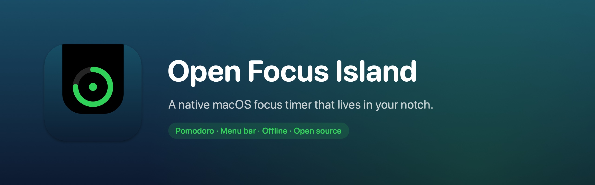
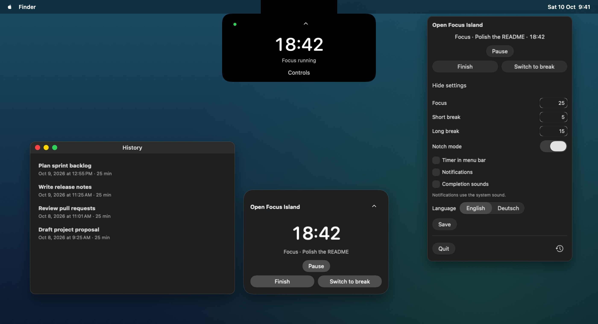
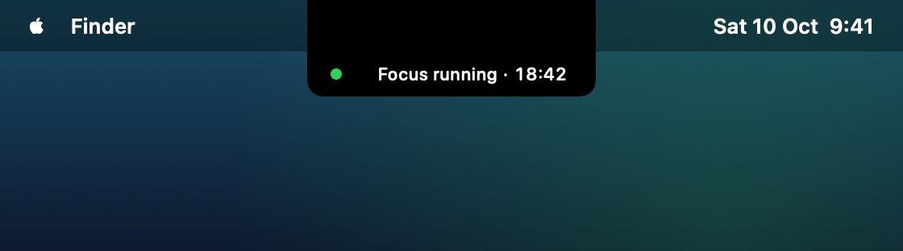
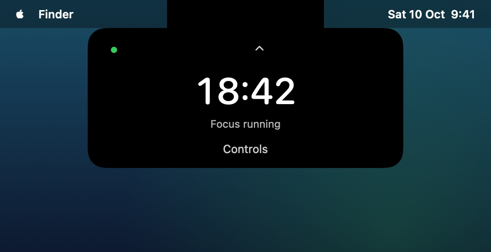
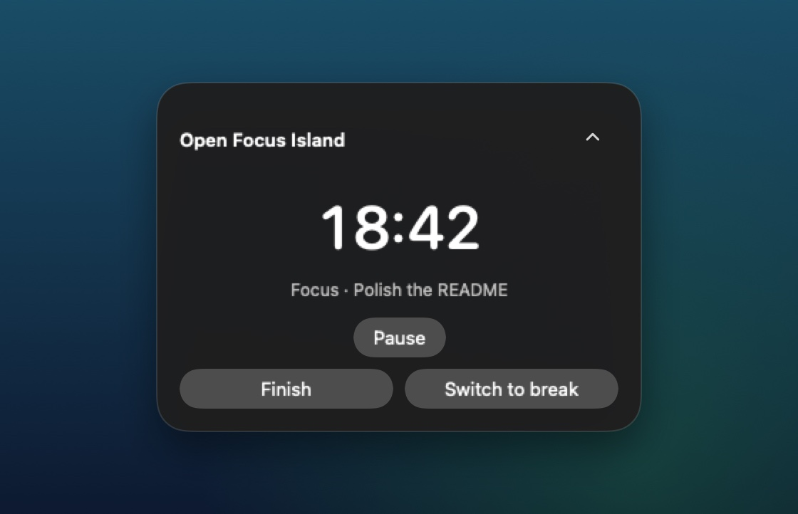
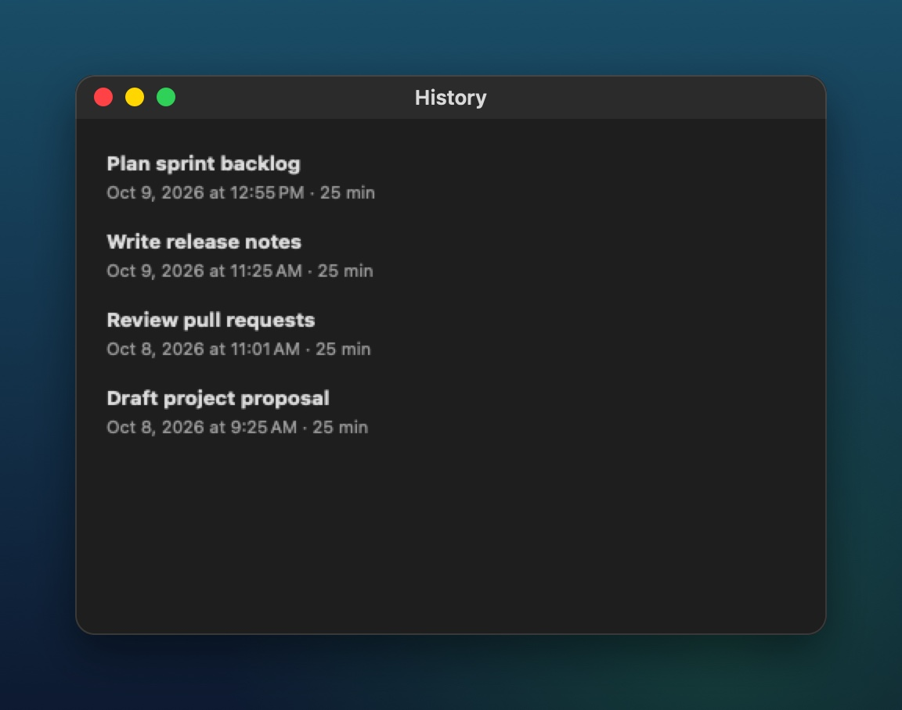
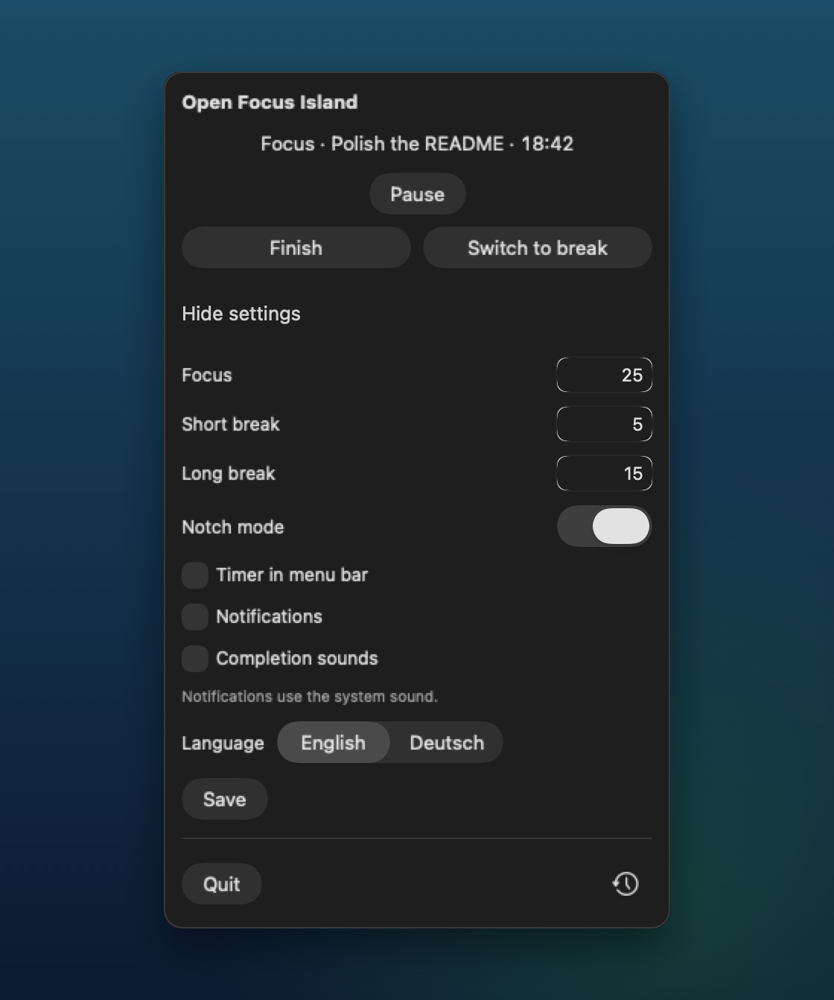

<p align="center">
  
</p>

<p align="center">
  <a href="https://github.com/alexandergorka/Open-Focus-Island/actions/workflows/ci.yml"></a>
  
  
  
  <a href="LICENSE"></a>
  <a href="https://github.com/alexandergorka/Open-Focus-Island/issues"></a>
  <a href="https://github.com/alexandergorka/Open-Focus-Island/stargazers"></a>
</p>

<p align="center">
  <b>Open Focus Island</b> is a native macOS Pomodoro timer with a compact island at the top of the screen and a menu-bar entry.<br>
  On MacBooks with a notch, the island attaches to the notch. Everything stays on your Mac: no account, no telemetry, no network.
</p>

<p align="center">
  
</p>

## Highlights

- 🏝️ **Lives in the notch.** A slim status strip next to the notch shows the countdown. Click to expand it, or drag the dot to detach the panel.
- ⏱️ **Classic Pomodoro.** 25 / 5 / 15 minutes by default, all configurable. After four full focus sessions the app suggests a long break.
- 📝 **Optional task names** and a live **History** window of completed focus sessions.
- 🔔 **Opt-in** notifications and completion sounds. Both are off by default.
- 🌍 **English and Deutsch.** Switching language takes effect immediately, without a relaunch.
- 💤 **Survives sleep and relaunch.** Remaining time is calculated from timestamps, not from a ticking counter.
- 🔒 **Private by design.** Settings, the current session and history are stored locally in `UserDefaults`.

## Screenshots

| Compact notch status | Expanded notch timer |
|:---:|:---:|
|  |  |
| **Floating controls** (no notch, or notch mode off) | **History** |
|  |  |

<p align="center">
  <br>
  <sub>Menu-bar popover with settings</sub>
</p>

## Installation

**Requirements:** macOS 14 or later. The app is universal (Apple Silicon and Intel).

### Homebrew

```sh
brew tap alexandergorka/open-focus-island https://github.com/alexandergorka/Open-Focus-Island
brew install --cask alexandergorka/open-focus-island/open-focus-island
```

### Download

Get the latest `Open-Focus-Island-<version>.zip` from [Releases](https://github.com/alexandergorka/Open-Focus-Island/releases/latest), unzip it, and move **Open Focus Island.app** to `/Applications`.

> [!IMPORTANT]
> Open Focus Island is not notarized by Apple yet, so macOS blocks the first launch.
> Open **System Settings → Privacy & Security** and click **Open Anyway**. You only need to do this once.

### Build from source

You need Swift 6 (Xcode or the Xcode command-line tools).

```sh
git clone https://github.com/alexandergorka/Open-Focus-Island.git
cd Open-Focus-Island
./scripts/build-app.sh
open ".build/Open Focus Island.app"
```

## Features in detail

<details>
<summary>Show the full feature list</summary>

- Start a focus or break session, with an optional task name.
- Expand the compact island to pause, resume, finish, or skip to a break.
- Smoothly expand and collapse the island in 280 ms, with a shared surface that changes size and corner rounding while the contents fade. macOS **Reduce motion** uses immediate transitions.
- Change focus, short-break, and long-break durations in settings.
- Open settings in the menu-bar popover using **Show settings** / **Hide settings** (German: **Einstellungen anzeigen** / **Einstellungen ausblenden**). The full heading row is clickable. The floating timer controls contain only session actions.
- Switch **Notch mode** on or off in settings. The choice is saved immediately; disabling it uses the floating display on every screen. Enabling it reconnects the panel to a supported notch.
- The compact notch status uses the measured notch width, a shallow strip with rounded bottom corners, and a visible countdown. Click the status or countdown to open the timer view; drag the status dot to detach the panel.
- Choose **English** or **Deutsch** under **Language** in settings. The choice is saved immediately and applied without a relaunch. Notifications, error messages, and history dates follow the selected language; a pending end-of-session notification is rescheduled in the new language, while an error message already shown keeps its text until it is next updated. System dialogs, such as the notification permission request, and system error texts follow the macOS system language.
- Open a separate, resizable **History** window using the history icon to the right of **Quit** in the menu-bar popover. It shows naturally completed focus sessions, updates live, and reuses the same window when opened again. Manual finishes and breaks are not included.
- Keep settings, the current session, and history locally in UserDefaults.
- Reconcile remaining time from session timestamps after sleep, app suspension, or relaunch. A focus session that expired while the app was closed is recorded on the next launch.
- Opt in to a local macOS notification at the end of a session. The app asks for notification permission only after you enable the setting.
- Enable optional completion sounds: F1 for focus and B5 for either break. Live completions play once within five seconds of the deadline. With notifications enabled, the system notification sound takes precedence; restore and older completions stay quiet.
- Place the island on the screen with the foreground app's topmost normal window. If that window cannot be determined, the app falls back to the main screen. The current MVP does not offer a monitor picker.

Default durations are 25 minutes for focus, 5 minutes for a short break, and 15 minutes for a long break. Notifications and app completion sounds are off by default. English is the default language, including for existing installations without a saved language.

After four fully elapsed focus sessions, the app recommends a long break. Every new session starts with a user action. Running sessions continue across relaunch; paused sessions remain paused.

The compact, timer and controls views share one animated background. Contents are measured at their final size to avoid resize feedback during animation; the transparent native window stays large enough to show the outgoing surface until collapse completes. Quick reversals replace the previous resize target, and dragging or changing displays cancels it. Timer ticks and dragging stay immediate.

The menu-bar popover grows and shrinks with its settings form. Oversized floating timer controls remain scrollable within the available screen area. Dragging from the status dot preserves the position on the same display and resets it when the active app moves to another display. Notched displays have connected compact-status, timer and controls views; the status distinguishes running, the last minute, paused and completed sessions.

</details>

## Development

```sh
swift build
swift test                      # 183 tests: FocusCore logic plus real AppKit/SwiftUI hosting windows
./scripts/build-app.sh          # release build → .build/Open Focus Island.app (ad-hoc signed)
./scripts/check-app-bundle.sh   # verifies bundle structure, plist, icon, signature and bundled sounds
```

| Path | Contents |
|---|---|
| `Sources/FocusCore` | Foundation-only value types: sessions, settings, persistence, notch and panel geometry |
| `Sources/OpenFocusIsland` | SwiftUI views, the observable controller, and AppKit panel and system integration |
| `Tests/` | `FocusCoreTests` (logic) and `FocusAppTests` (rendered UI, interaction, sound and notification policy) |
| `scripts/` | App bundle build and audit, plus the icon and sound generators |
| `Assets/` | App icon and the synthesized completion sounds with their manifest |
| `Casks/` | Homebrew cask, updated automatically on release |

`build-app.sh` builds the release executable, includes the app icon and the completion sounds with their manifest, sets the bundle version from `APP_VERSION` (default `0.1.0`), and applies an ad-hoc local signature. `UNIVERSAL=1` builds for Apple Silicon and Intel (requires Xcode).

Some tests render real windows and need a logged-in macOS session. Notch-specific tests are skipped on displays without a notch.

### Releasing

Push a version tag, for example `git tag v0.2.0 && git push origin v0.2.0`. The [release workflow](.github/workflows/release.yml) builds the universal app, publishes a GitHub release with the zip, and updates `Casks/open-focus-island.rb` on `main`.

## Project status

Open Focus Island is an early MVP (`0.1.0`).

- Releases are ad-hoc signed, not signed with an Apple Developer ID or notarized. That's why macOS asks you to confirm the first launch.
- Not yet verified on real hardware: physical display unplugging, VoiceOver, and actual sleep/wake. Subjective sound quality has not been evaluated either.
- Planned: automatic Apple Focus ("Do Not Disturb") integration, see [`TODO.md`](TODO.md).

Bug reports and ideas are welcome in the [issue tracker](https://github.com/alexandergorka/Open-Focus-Island/issues).

## Product direction

The app is an original implementation and uses its own name, icon, layout, copy, and code. It does not include accounts, telemetry, network access, cloud sync, music controls, dictation, translation, calendar, weather, system HUDs, AI progress, app blocking, or device sync.

## License

[MIT](LICENSE) © 2026 Alexander Gorka
